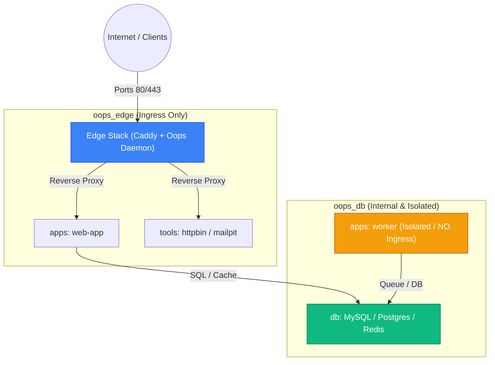

# Oopsbox Blueprint

Oopsbox is the production-ready, turnkey Infrastructure as Code (IaC) blueprint for **Oops**. It enforces **1:1 Dev-to-Prod Parity** across local developer workstations (macOS / Linux) and production servers, while enabling fully **Git-driven infrastructure updates** with zero manual SSH configuration editing.

## Directory Topology

```text
~/oopsbox/                # Standard Root Directory (or /opt/oopsbox on production)
├── .env                  # Environment variables & secrets (copy from .env.example)
├── .env.example          # Credentials template (Committed)
├── oops.yaml             # Pure Oops system configuration (x-oops:) (Committed)
├── oops.yaml.example     # Pure Oops config blueprint for remote /@<remote>/oops.yaml
├── oopsbox.yaml          # Local Workstation Engine & DNS settings (git-ignored)
├── oopsbox.yaml.example  # Workstation configuration template (Committed)
├── compose.yaml          # Local Root Base Manifest (x-oops-stack & oops_default network)
├── compose.yaml.example  # Blueprint for remote /@<remote>/compose.yaml
├── compose.edge.yaml     # Edge stack (caddy-proxy, oops daemon, oops_edge network)
├── compose.db.yaml       # Database stack (mysql, postgres, redis, oops_db network)
├── compose.storage.yaml  # Object Storage stack (seaweedfs, oops_storage network)
├── compose.tools.yaml    # Developer tools stack (httpbin, mailpit)
├── .oopsallow.example    # Whitelist blueprint for capsule sync
├── config/               # Version-controlled service configuration (e.g., caddy/Caddyfile)
├── data/                 # Live realtime container storage (High-IOPS persistent volume)
│   ├── mysql/            # MySQL storage
│   ├── postgres/         # PostgreSQL storage
│   ├── caddy/            # SSL certificates
│   └── oops/             # Oops Daemon runtime data
│       └── dns.records   # Local Node Custom DNS Records
└── backups/              # Secondary backup storage (Cold storage / database dumps)
```

---

## Network Segmentation & Security

Oops Stack enforces the **Principle of Least Privilege & Network Isolation**:



- **`oops_default`**: Declared in `compose.yaml` as the trusted core network (`subnet: 10.240.0.0/24`, `ip_range: 10.240.0.128/25`). Static IPs are reserved for core infrastructure (`10.240.0.2` for Oops daemon, `10.240.0.3` for Caddy edge proxy), while all dynamic containers receive IPs starting from `10.240.0.128` upwards.
- **`network.subnet` in `oops.yaml`**: Authoritative L3 subnet envelope for this host / remote capsule (`10.240.0.0/24`). For multi-remote setups, assign distinct `/24` subnets (e.g. `@server1: 10.240.0.0/24`, `@server2: 10.240.1.0/24`) to prevent tunnel routing collisions. If hosting multiple isolated networks on a single machine, expand the host envelope to `/16` (`10.240.0.0/16`).

---

## Quickstart (Local Development)

### Create or Initialize Workspace (`oops box init [path]`)
Provision a new Oopsbox workspace from the latest official blueprint with generated cryptographic credentials and active box registration:
```bash
oops box init ~/oopsbox
```

### Start Dev Environment (`oops box start`)
Starts VM engine (OrbStack/Colima/Docker), configures local DNS resolver, syncs DNS records, and boots default stack:
```bash
cd ~/oopsbox
oops box start
```

### Install Trusted Local SSL Certificate (`oops box cert`)
Adds Caddy's local root CA certificate to macOS Keychain or Linux system trust store (enables green locks for `https://*.web.oops`):
```bash
oops box cert
```

### Switch Active Oopsbox (`oops box switch <path>`)
Seamlessly switch between multiple isolated organization workspaces without port or container name collisions:
```bash
oops box switch ~/Workspaces/another-org/oopsbox
```

---

## Unified Configuration (`oops.yaml`)

`oops.yaml` is a pure system configuration file holding orchestrator settings under `x-oops:` (`secret`, `db`, `orchestrator`, `backup`, `dns`, `volume`, `registries`):

```yaml
x-oops:
  secret: ${OOPS_SECRET:-}

  db:
    mysql_password: ${OOPS_DB_MYSQL_PASSWORD:-}
    postgres_password: ${OOPS_DB_POSTGRES_PASSWORD:-}
    redis_password: ${OOPS_DB_REDIS_PASSWORD:-}

  registries:
    gar: asia-southeast1-docker.pkg.dev/my-project/my-repo
    my_org: ghcr.io/my_org
    hub: docker.io/myorg

  dns:
    tld: oops
    upstreams:
      - 1.1.1.1:53
      - 8.8.8.8:53
```

Use the `/<stack>` or `/<stack>/<service>` target syntax with any `oops` command:
```bash
oops up                     # Starts stacks/services listed in compose.yaml x-oops-stack in order
oops up /edge               # Starts Edge Stack (caddy-proxy, oops)
oops up /db                 # Starts Database Stack (mysql, postgres, redis)
oops up /db/mysql           # Starts only MySQL inside the /db stack
oops up /storage            # Starts Object Storage Stack (SeaweedFS)
oops up /tools              # Starts Dev Tools Stack (httpbin, mailpit)
oops restart /edge

# Switch active stack (starts target stack & stops all other running services):
oops switch /apps

# Stop all services except specified exclusions:
oops stop -x /edge
oops stop -x /edge -x redis
```

---

## Compose Extension Fields (`x-oops-stack`)

Oops manifests use `x-oops-stack:` to control both **selective auto-start** and **top-to-bottom boot order**:

| Extension Field | Placement | Purpose & Behavior |
| :--- | :--- | :--- |
| **`x-oops-stack:`** | `compose.yaml` & `compose.<stack>.yaml` | Explicit auto-start whitelist and execution order. Services or stacks omitted from `x-oops-stack:` do NOT auto-start on `oops up`. |
| **`x-oops-depends:`** | `compose.<stack>.yaml` | Additional runtime dependencies auto-started along with target stack (`oops up /<stack>`). |

---

## DNS Management CLI (`oops dns`)

Inspect, query, and manage DNS resolution directly:
```bash
# List all active DNS records (Custom, Infra, and Container Services)
oops dns
oops dns list

# Query resolved IP for a domain
oops dns get host.oops
oops dns get mysql.oops

# Set or update a custom record (upsert)
oops dns set my-app.test 127.0.0.1
oops dns set .wild.test 192.168.1.100

# Delete a custom record
oops dns del my-app.test

# Validate and reload daemon DNS table
oops dns reload
```

---

## Global Oops CLI Usage

You can also use `oops` natively or via container alias from any directory:

```bash
# Set up Host Alias in ~/.zshrc or ~/.bashrc:
alias oops='docker run --rm -it \
  -v /var/run/docker.sock:/var/run/docker.sock \
  -v "$HOME/oopsbox":"$HOME/oopsbox" \
  -w "$HOME/oopsbox" \
  ghcr.io/noyzilla/oops:latest'

# Pull images across all stacks, specific stack, or registry alias
oops pull --all
oops pull /apps
oops pull gar/my-app:v1.0.0

# Start stacks or specific services
oops up                     # Starts stacks/services in compose.yaml x-oops-stack
oops up /edge               # Starts Edge Perimeter (Caddy + Oops Daemon)
oops up /db                 # Starts Databases (MySQL, Postgres, Redis)
oops up /storage            # Starts Object Storage (SeaweedFS)
oops up /tools              # Starts Dev Tools (httpbin, mailpit)
oops up /apps               # Starts Applications

# Target specific services or wildcard
oops up mysql
oops up /db/mysql
oops up httpbin
oops up mailpit
oops up app..

# Switch profiles and stop other services
oops switch /edge
oops stop -x /edge
```

---

## Stack Operations

### Sequential Rolling Updates (Zero Downtime)
Deploy updates across apps sequentially with automated health check polling:
```bash
oops update app.. -d 2s
oops update app1
oops update --image gar/my-app:v1.0.0
```

### Database Provisioning & Password Management
Create databases, dedicated users, and rotate passwords (auto-generates 20-character secure passwords and exports credentials to `config/env/<container>.<db>.env`):
```bash
# MySQL
oops db mysql create myapp_db                       # Auto-generates password & exports .env (User implicitly matches DB name)
oops db mysql:mysql-analytics create report_db      # Target specific container (exports config/env/mysql-analytics.report_db.env)
oops db mysql readonly myapp_db metabase            # Provision SELECT-only readonly user (myapp_db__ro_metabase)
oops db mysql passwd myapp_db                       # Rotate password (auto-generates new)
oops db mysql passwd myapp_db myNewPass123          # Set explicit password
oops db mysql create app_db -n                      # Skip exporting .env file
oops db mysql list
oops db mysql drop myapp_db

# PostgreSQL
oops db postgres create myapp_db                    # Auto-generates password
oops db postgres:pg-custom create analytics_db      # Target specific container
oops db postgres readonly myapp_db metabase         # Provision SELECT-only readonly user
oops db postgres passwd myapp_db                    # Rotate password (auto-generates new)
oops db postgres list
oops db postgres drop myapp_db
```

### Automated Backup Suite (Database & Data Volumes)
Execute automated database dumps, filesystem data packaging, and prune expired archives older than `retention` (default `7d`):
```bash
# Full System Backup (Database Dumps + Data Volumes)
oops backup                         # Full backup (DB + Data) and prune expired
oops backup prune                   # Prune all expired archives (no dump)

# Database Backup Only (MySQL, PostgreSQL)
oops backup-db                      # Backup all databases
oops backup-db mysql                # Backup specific database
oops backup-db postgres -r 14d      # Backup with custom 14-day retention
oops backup-db prune                # Prune expired DB dump archives

# Data Volumes & Filesystem Backup Only (Uploads, Storage, Certs)
oops backup-data                    # Backup all targets defined in oops.yaml
oops backup-data uploads            # Backup specific data target
oops backup-data prune              # Prune expired data volume archives
```

### Webhook Automation (CI/CD)
Trigger deployments from GitHub Actions or GitLab CI via the Webhook Engine:
```bash
curl -X POST https://webhook.yourdomain.com/deploy \
  -H "Authorization: Bearer your_secret_token" \
  -H "Content-Type: application/json" \
  -d '{"target": "app..", "mode": "image"}'
```
